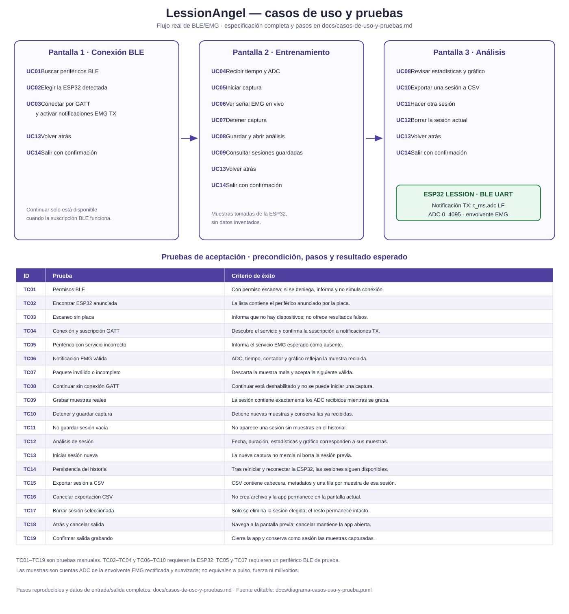

# LessionAngel

Aplicación Android para conectar por BLE con la ESP32 LESSION, ver la señal EMG recibida en tiempo real, guardar sesiones y exportar cada sesión a CSV.

La placa transmite una envolvente EMG rectificada y suavizada como cuentas ADC (`0–4095`), junto con el tiempo desde su arranque. Estos valores no representan frecuencia cardíaca, fuerza muscular ni milivoltios.

## Casos de uso y pruebas

El diagrama resume el flujo real de la app y los criterios de aceptación:



- [Casos de uso y pruebas de aceptación detallados](docs/casos-de-uso-y-pruebas.md): precondiciones, pasos y resultados esperados para cada prueba.
- [Fuente PlantUML del diagrama](docs/diagrama-casos-uso-y-prueba.puml).

Las pruebas BLE de aceptación requieren una ESP32 configurada con el sketch `ESP32_LESSION.ino`. Los casos descritos son pruebas manuales de aceptación; los tests automatizados Android se ejecutan con:

```powershell
.\gradlew.bat test
.\gradlew.bat connectedDebugAndroidTest
```
